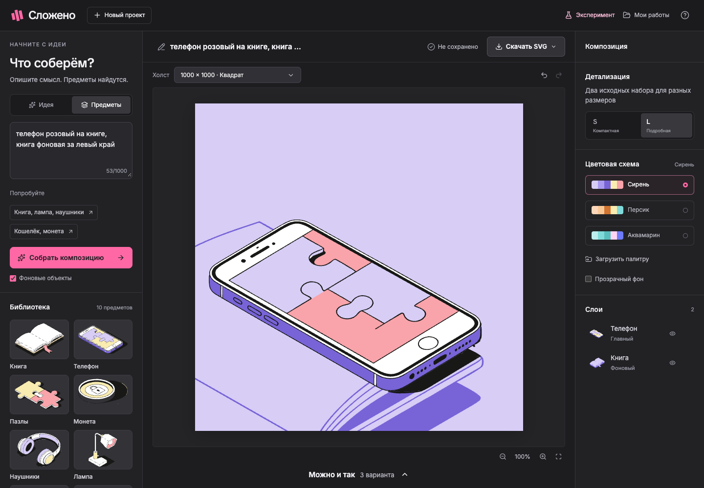
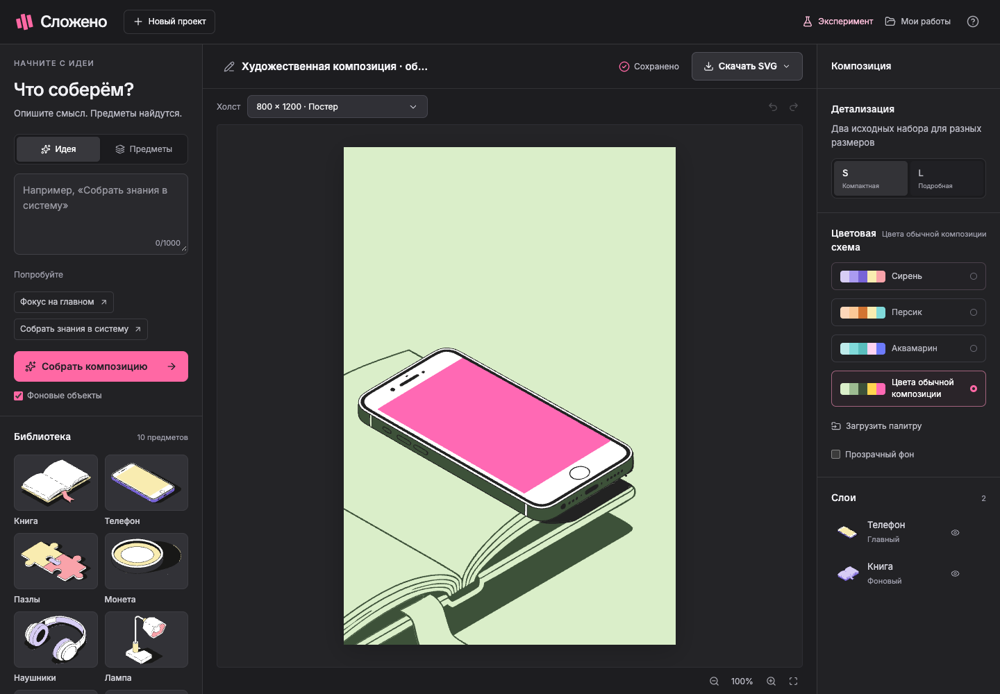
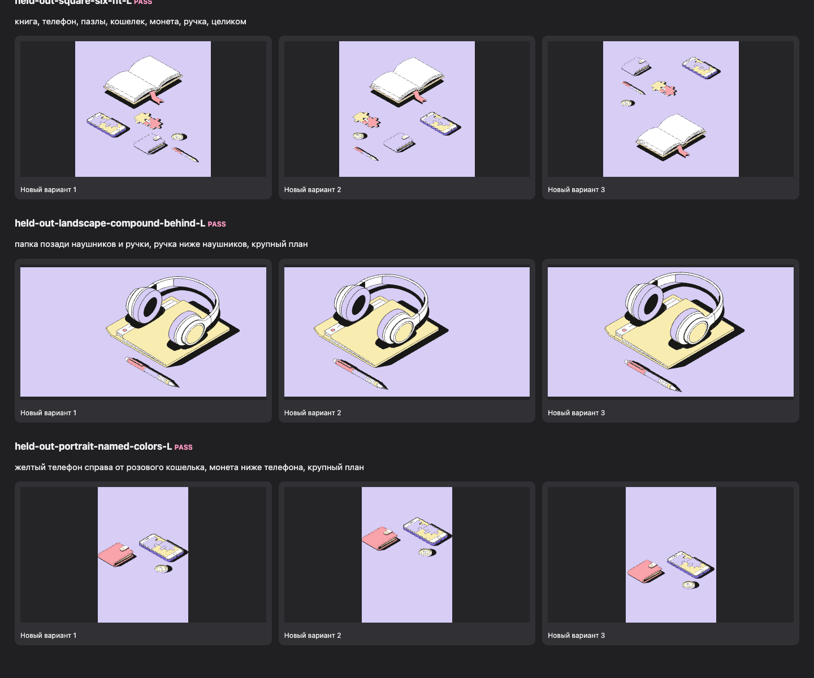
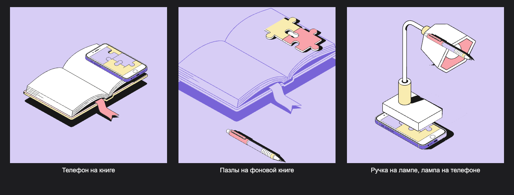

# Сложено · Редактор иллюстраций

Веб-конструктор иллюстраций по метафоре или названиям предметов. Тестовое задание
для Junior AI Developer в продукт Снэпбилд студии Очень. Это самостоятельная работа
кандидата, не официальный продукт компании.

OpenAI подбирает существующие предметы, алгоритм собирает три композиции,
пользователь редактирует результат и скачивает SVG. Новые контуры не генерируются.



[Итог V1](docs/V1.md) · [Деплой и пароль](docs/DEPLOYMENT.md) · [Журнал выпуска](docs/RELEASE.md)

[Короткое демо](docs/evidence/demo.webm) · [Примеры SVG и JSON](examples/compositions/manifest.json)

Обычная и экспериментальная версии приняты пользователем 11 ноября 2026.
Сайт развёрнут на **[true-4.ru](https://true-4.ru)**. Введите пароль проверяющего;
после входа в том же браузере доступен [Swagger](https://true-4.ru/docs).
Подтверждённые версии, проверки и backup: [журнал выпуска](docs/RELEASE.md).

## Возможности

- Два сценария: метафора/заголовок и названия предметов с синонимами.
- Пространственные указания: слева/справа, над/под, на, позади/перед и группы
  вроде «пазл на монете, а под ними книга». Все три варианта сохраняют эти связи.
  Обычная раскладка избегает пересечений полных SVG; намеренный контакт задаётся запросом.
- Художественные указания: крупный план, выход за выбранный край, главный/фоновый
  предмет и цвет его основной поверхности. Общий масштаб сохраняет исходные пропорции.
- 10 семейств, 40 оригинальных вариантов: настоящие S/L × главные/фоновые.
- Три раскладки и девять популярных размеров, включая Full HD, 4:3 и истории.
  При смене размера обычная композиция вписывается; намеренное крупное кадрирование сохраняется.
- Перемещение мышью/клавиатурой, ручки изменения размера и поворота,
  плавающая панель действий, Ctrl/Cmd C/V, слои, скрытие, блокировка, undo/redo.
- Полноэкранный редактор, масштабирование и прокрутка увеличенного холста.
- Три исходные схемы, интерактивное создание палитры и понятный импорт JSON.
- PostgreSQL, автосохранение, галерея работ сессии, обнаружение конфликта вкладок.
- Самостоятельный редактируемый SVG и переносимый JSON-проект.
- Обычные тени на видимых поверхностях нижних слоёв. Явные опоры вроде
  «ручка на лампе» сохраняются в проекте и убирают остаток тени в воздухе.
- Отдельная экспериментальная мастерская: общий свет, индивидуальная «Своя тень» и пошаговая инструкция со скриншотами.
- Парольная страница с защитой API, библиотеки, Swagger/ReDoc и OpenAPI;
  в production пароль обязателен, локально его можно выключить.
- Тёмный интерфейс по мотивам Snapbuild, Inter и TikTok Sans.
- Единый логотип на странице входа, в редакторе и галерее работ.

## Художественные указания в запросе

Можно писать, например:

- «Телефон розовый на книге, книга фоновая за левый край».
- «Наушники справа от папки, крупный план».
- «Жёлтый телефон справа от розового кошелька, монета ниже телефона, крупный план».
- «Монета слева от ручки, целиком».

Алгоритм сначала сохраняет пространственные связи, затем сравнивает варианты
упаковки и выбирает общий масштаб и кадр. В продукте нет координат или шаблонов
из примеров Figma. Короткий список предметов по умолчанию целиком вписывается;
крупный план и выход за край можно задать словами. AI передаёт такие же смысловые
указания, а не положения отдельных предметов.

Цвет меняет основную цветную поверхность предмета, сохраняя остальные детали.
Используются только цвета текущей палитры; если нужного оттенка в ней нет,
выбирается ближайший допустимый. Фоновые предметы используют только фоновые цвета.
Назначения ролей сохраняются в JSON и работают с пользовательскими палитрами.



Сравнение с исходными примерами, все три варианта и новые сочетания предметов:
[визуальный аудит](examples/art-direction/index.html).
В скачанном репозитории этот HTML можно открыть прямо в браузере.
Сходство композиционных приёмов проверяется отдельно от совпадения пикселей:
декоративные линии и геометрические подложки из Figma не добавляются.



[Подробная проверка этой доработки](docs/ART_DIRECTION_ACCEPTANCE.md).

## Запуск с Docker

Нужен Docker с Compose. Из корня репозитория:

```bash
cp .env.example .env
# При необходимости заполнить OPENAI_API_KEY и HTTP_PROXY.
docker compose up --build -d
```

Если `.env` уже существует, сохраните его и добавьте недостающие настройки вручную.
Редактор: [127.0.0.1:8017](http://127.0.0.1:8017),
[OpenAPI](http://127.0.0.1:8017/docs). По умолчанию сервис доступен только на localhost.
PostgreSQL сохраняется в отдельном volume `ochen-illustrations_postgres-data`.

```bash
docker compose ps
docker compose logs --tail 50 web
docker compose down
```

`down` сохраняет данные. `down -v` удаляет базу; для обычной остановки этот флаг не нужен.
Другой порт: `OCHEN_APP_PORT=8018 docker compose up --build -d`.
При собственном порте добавьте его origin в `ALLOWED_ORIGINS`.

## Разработка

Нужны Python 3.12+, Node.js 22.12+ и Docker для PostgreSQL:

```bash
make install
make dev
```

Редактор: [127.0.0.1:5178](http://127.0.0.1:5178), API: `127.0.0.1:8017`,
PostgreSQL 17: `127.0.0.1:54329`, база/пользователь `illustrations`.
Пароль разработки задаётся через `POSTGRES_PASSWORD`; его значение должно
совпадать с `DATABASE_URL` в `.env`. Значение по умолчанию предназначено для локального запуска.

Порты выбраны отдельно от других локальных проектов. `make dev` применяет миграции,
запускает оба dev-сервера; Ctrl+C останавливает их. Docker- и native-режимы приложения
занимают один порт 8017, запускайте один из них.

## OpenAI и прокси

```dotenv
OPENAI_API_KEY=
OPENAI_MODEL=gpt-6-luna
HTTP_PROXY=
AI_REQUEST_LIMIT=100
AI_SESSION_LIMIT=20
```

Ключ и прокси находятся только в `.env`, исключённом из Git и Docker build context.
`HTTP_PROXY` явно передаётся HTTPX, включая HTTPS-запросы к OpenAI.
При пустом значении используется прямое соединение.

Модель получает только запрос и небольшой смысловой каталог. Responses API возвращает
строго структурированные ID, пространственные отношения, художественные указания
и объяснение; Pydantic повторно проверяет ответ.
Инструментов рисования, исполнения кода и доступа к SVG у модели нет.
`store=false`, timeout 35 секунд, максимум 2200 выходных токенов.
Дневные лимиты по UTC сохраняются в БД, неудачные попытки тоже учитываются.
Подбор по идее автоматически использует OpenAI при настроенном ключе;
переключателя провайдера в интерфейсе нет.
Небольшой кеш успешных подборов сокращает повторные обращения.
Одновременно выполняются не более двух подборов на процесс и одного на сессию;
повторный запрос отклоняется до списания дневного лимита. V1 запускается одним worker.

Без ключа доступны редактор, подбор названий и явно обозначенный словарный режим.
Словарь ограничен несколькими темами. Сбой OpenAI не заменяет текущую сцену.
Реальное обращение через прокси проверено локально; платные вызовы не входят в CI.
Официальные источники: [модель](https://developers.openai.com/api/docs/models/gpt-6-luna),
[структурированные ответы](https://developers.openai.com/api/docs/guides/structured-outputs).

## Архитектура и SVG

```text
backend/app/          API, схема сцены, подбор, OpenAI, БД, SVG-экспорт
backend/migrations/   Alembic
backend/tests/        модульные и API-регрессии
frontend/src/         React, SVG-холст, история, слои и настройки
frontend/e2e/         Playwright с настоящим API и PostgreSQL
assets/originals/     неизменённые экспорты разделов Figma
assets/library/       извлечённые оригинальные предметы
assets/catalog.json   происхождение, размеры, варианты, хеши и смысловые теги
examples/             демонстрационные композиции и палитра
```

**Хранение:** SVG и каталог версионируются файлами. PostgreSQL хранит Scene JSON,
владельца браузерной сессии, ревизии и лимиты AI. SQLite используется во временных тестах.

**Извлечение:** разделы L/S экспортированы из Figma с ID. Скрипт копирует предметные
группы, добавляет два отдельных контура книги и нормализует начало координат внешним
transform. Path data сохраняется. Воспроизведение без Figma:

```bash
.venv/bin/python scripts/import_catalog.py
```

**Переиспользование:** сцена хранит семейство, детализацию, роль, положение, угол
и порядок экземпляра. Общий масштаб сохраняет относительные размеры исходников.
S/L переключает реальные контуры. Автосборка использует один общий масштаб;
ручное растяжение рамкой сохраняется как отдельная трансформация экземпляра.

**Цвет:** значения меняются по ролям от неизменённого оригинала. Главные предметы
могут использовать обе группы, фоновые только фоновые слоты. Переключение схем
не накапливает погрешности. Пример импорта: [examples/palette.json](examples/palette.json).

**Экспорт:** отдельные группы, уникальные SVG ID, локальные ссылки и граница холста.
Растр, scripts, XML-сущности, внешние ресурсы и `foreignObject` не используются.

**Сохранение:** HttpOnly-cookie определяет сессию; проекты разных сессий изолированы.
Запись требует CSRF-токен и допустимый origin. Ревизии предотвращают тихую перезапись
другой вкладкой: конфликт позволяет сохранить отдельную копию. Для переноса между
браузерами служит JSON, ссылка с ID без сессии доступа не даёт.

## Проверки

```bash
make check   # tests, Python/frontend lint, format и production build
make e2e     # PostgreSQL, миграции и настоящие браузерные сценарии
```

Локально Playwright использует Google Chrome. Если его нет, выполните
`cd frontend && npx playwright install chromium` и запустите
`CI=true npx playwright test` с остановленными dev-серверами.
GitHub Actions использует отдельный PostgreSQL и Chromium.

Проверяются геометрия, S/L, палитры, ID, безопасный XML, подбор предметов,
ошибки AI, прокси, лимиты, изоляция сессий, ревизии, история, drag, экспорт,
переключение проектов и восстановление. Подменяется только внешний HTTP-транспорт,
реальный код обработки AI проверяется полностью. Результаты: [приёмка](docs/ACCEPTANCE.md).
Продуктовый baseline `8bf51d2`: 1857 Python-тестов, 172 frontend-теста,
58 сценариев Playwright; покрытие backend с учётом ветвлений 95%.
Production-подготовка дополнительно проверяет скрытую форму, Compose, буквальную
передачу секретов и HTTPS-защиту Swagger: 1868 pytest, покрытие backend 96%.
Результаты публичного выпуска фиксируются отдельно в [журнале](docs/RELEASE.md).
Отдельная регрессия проверяет дробные положения и малые масштабы контактной тени,
включая сохранность непрозрачных деталей предмета.

Стрелки двигают предмет на 1 px, Shift + стрелки на 10 px. ⌘/Ctrl + Z отменяет,
Shift + ⌘/Ctrl + Z повторяет, ⌘/Ctrl + D дублирует, ⌘/Ctrl + S сохраняет,
Delete удаляет выбранный предмет или отдельно выбранную тень. Поворот доступен
ручкой рамки и в настройках; Ctrl/Cmd C/V копируют и вставляют предмет.

## Объём V1

Основной сценарий рассчитан на desktop, на узких экранах панели сворачиваются.
Библиотека подготовлена заранее. Проекты принадлежат текущей сессии браузера.
Индивидуальные аккаунты, совместное редактирование и импорт произвольных SVG
не входят в V1. Для проверяющих предусмотрен общий пароль доступа.
Код и данные других приватных проектов сюда не переносились.

Дальнейшие улучшения: фиксация предметов при пересборке, адаптация сразу под несколько
форматов и оценка подбора на большом наборе метафор.

## Инструменты и источники

- Codex: исследование, архитектура, код, тесты, документация и проверка интерфейса.
- OpenAI GPT-6 Luna: смысловой подбор в работающем приложении.
- Figma MCP и Figma Desktop: чтение ТЗ и получение исходных векторов.
- Playwright: воспроизводимые проверки пользовательских сценариев.

[ТЗ в Figma](https://www.figma.com/design/dnuDZosHkN6ajkhiVfavRw/?node-id=26-11438),
[исследование](docs/RESEARCH.md), [предложение](docs/PROPOSAL.md),
[инструкции агентам](AGENTS.md), [права на исходные иллюстрации](assets/NOTICE.md).

## Опоры и общий источник света

В запросе «лампа стоит на телефоне и на лампе лежит ручка» редактор сохраняет
цепочку опор во всех трёх вариантах. Исходная тень лампы попадает на телефон,
а ручки — на лампу. Точки контакта и принимающая поверхность вычисляются из самих
исходных контуров: [подготовка метаданных](scripts/prepare_contact_metadata.mjs).
Это данные геометрии предмета, не координаты готовой композиции. Непрозрачные
поверхности и просветы учитываются в SVG-масках;
верхние слои также могут затенять видимые поверхности ниже без ручного назначения опор.
У несвязанных предметов сохраняется исходный отпечаток на плоскости; у явно поднятого
предмета остаётся только часть на его опорах.
Для ранее созданных сцен опору можно назначить вручную в настройках предмета.
Удаление и смена порядка слоёв очищают пересечённые связи; перемещение и S/L их сохраняют.



Переносимые проекты для самостоятельной проверки:
[телефон на книге](examples/art-direction/contact/phone-book.json),
[пазлы на фоновой книге](examples/art-direction/contact/puzzle-book.json),
[цепочка опор](examples/art-direction/contact/chain.json).

Нажмите «Эксперимент» в шапке редактора. Откроется отдельный режим с пошаговой
инструкцией: реальные скриншоты, стрелки, кликабельные подсказки и кнопка
«Показать в редакторе». Инструкцию можно открыть снова из панели режима.

В эксперименте снимите выделение и включите «Общий источник света» в правой панели. Перемещайте
метку солнца на холсте, меняйте высоту и плотность теней. Источник управляет всеми
предметами, а сохранённые индивидуальные настройки возвращаются после выключения.
Это 2D-проекция: нарисованные блики и объём исходной иллюстрации остаются исходными.
Метка не входит в SVG-экспорт. Перемещение поддерживает клавиатуру, undo/redo и отмену.

Обычный редактор всегда открывается по умолчанию и игнорирует экспериментальные
параметры в сохранённых проектах. Кнопка «Обычный редактор» возвращает исходные
тени, сохраняя настройки для следующего входа. Геометрия и палитра проекта общие
для обоих режимов. Галерея использует обычные превью. SVG экспортируется в текущем
режиме; API требует явного `POST /api/export?experimental=true` для эксперимента.
Тени на опорах работают в обоих режимах, без остатка тени рядом с поднятым предметом.

Чтобы полностью скрыть вход в эксперимент:

```dotenv
CUSTOM_SHADOWS_ENABLED=false
```

Перезапустите сервис и обновите страницу. «Своя тень», общий свет и все их ручки и
подсказки исчезнут, превью/экспорт вернутся к исходным теням. Сохранённые настройки
не удаляются. **Тени на опорах продолжат работать.** Локально вход в эксперимент доступен; сам режим выключен до явного входа.

[Тени на опорах: сравнение трёх вариантов](docs/evidence/receiver-shadows-chain.png),
[редактор со светом](docs/evidence/scene-light-editor.png),
[редактор с обычными контактными тенями](docs/evidence/receiver-editor.png).

## Дополнительный режим «Своя тень»

Войдите в экспериментальную мастерскую, выберите предмет в слоях и включите
«Своя тень» в его настройках. Режим действует
только на выбранный экземпляр. Исходная тень скрывается, а чёрная SVG-копия тела
проецируется относительно неподвижной линии опоры. Просветы силуэта сохраняются,
поперечная ширина не растягивается. Тело и основание закрывают проекцию под собой.

Потяните видимую тень или круглую ручку рамки, чтобы изменить направление и длину.
Другая ручка меняет только направление. Новые жесты ограничены длиной 0–200%; 100%
означает стандартную длину проекции, начальное направление — 90° вниз.
Непрозрачность задаёт плотность цвета. Кнопки у числового угла поддерживают удержание.
Стрелки клавиатуры меняют вектор выбранной проекции; один жест отменяется одним undo.
Выключение режима возвращает исходную иллюстрацию.

Аффинная 2D-проекция не перестраивает исходные блики и геометрию предмета.
У несвязанных предметов сохраняется исходный отпечаток на плоскости; видимые
нижние поверхности могут принимать его. При заданной опоре её
видимая поверхность принимает тень верхнего предмета; сам предмет рисуется выше.
У монеты замыкается нижняя дуга стенки, слитая с тенью в оригинале, только в этом режиме.
SVG-исходники остаются неизменными; эффект экспортируется векторными группами и масками.
Обычные предметы сохраняют исходный рисунок. При разделении слоёв может отличаться
сглаживание краёв; внутренние области проверяются отдельно. Настройки участвуют
в undo/redo, дублировании, S/L, сохранении и переносимом JSON.

Разметка масок привязана к хешам в `assets/shadow-map.json`. Подготовка после изменения
библиотеки: `node scripts/prepare_shadow_metadata.mjs` (нужны frontend dev-зависимости
и Chrome), затем визуальная сверка всей матрицы. При обычном запуске браузер для
подготовки библиотеки не нужен.

[Силуэты S/L в четырёх направлениях](docs/evidence/silhouette-shadow-review.png)

## Пароль для проверяющих

Локально пароль по умолчанию выключен. Для публичного развёртывания задайте в `.env`:

```dotenv
SITE_PASSWORD=
REQUIRE_SITE_PASSWORD=true
AUTH_SECRET=
COOKIE_SECURE=true
```

Заполните пароль и случайный AUTH_SECRET длиной не менее 32 символов.
Под HTTPS COOKIE_SECURE должен быть true; на обычном локальном HTTP — false.
При REQUIRE_SITE_PASSWORD=true и пустом пароле сервис откажется запускаться.
Сессия входа подписана, HttpOnly/SameSite=Lax, действует 8 часов; смена пароля
аннулирует прежний вход. Защищены API, исходная библиотека и OpenAPI,
вход ограничен по частоте. Истечение входа сохраняет несохранённую работу в редакторе.
Пароль и ключи не попадают в сборку frontend или Git. Production-конфигурация для
`true-4.ru` находится в `compose.production.yaml`: пароль обязателен, БД не публикует порт,
cookie передаются только по HTTPS. [Скрытая форма в Termius и порядок выпуска](docs/DEPLOYMENT.md).


## Темы и защита AI

Окно принимает заголовки, абстрактные и технические темы, вопросы и названия предметов.
Если буквального предмета нет, OpenAI выбирает ближайшую метафору из библиотеки.
Явные команды написать скрипт, сменить роль или раскрыть инструкции блокируются
понятной ошибкой; модель не имеет инструментов исполнения кода.
Автоматические проверки используют подставного провайдера. В дополнительной живой
выборке 8/8 обычных тем прошли через настроенный прокси; это наблюдение,
а не гарантия доступности внешнего API на любой будущий запрос.

## Проверка по исходным примерам Figma

[Сравнение всех 18 примеров](examples/figma-reference/index.html),
[результаты и ограничения](examples/figma-reference/REPORT.md).
Проверены 108 результатов по названиям (3 варианта × S/L) и 54 результата по
пространственным описаниям. Все 54 описательные сцены сохраняют заданные
макроотношения; платных вызовов не было.
Этот первоначальный аудит сохранён как исторический baseline. После него алгоритм
научился общим указаниям крупности, кадрирования, ролей и цветов; новый аудит дал
324/324 проверки. [Актуальное сравнение](examples/art-direction/index.html) и
[финальная проверка](docs/ART_DIRECTION_ACCEPTANCE.md) показывают три варианта и новые
сочетания без переноса готовых координат. Декоративные подложки и точное пиксельное
повторение Figma не заявляются. Прежние ошибки и результаты не удалены.
