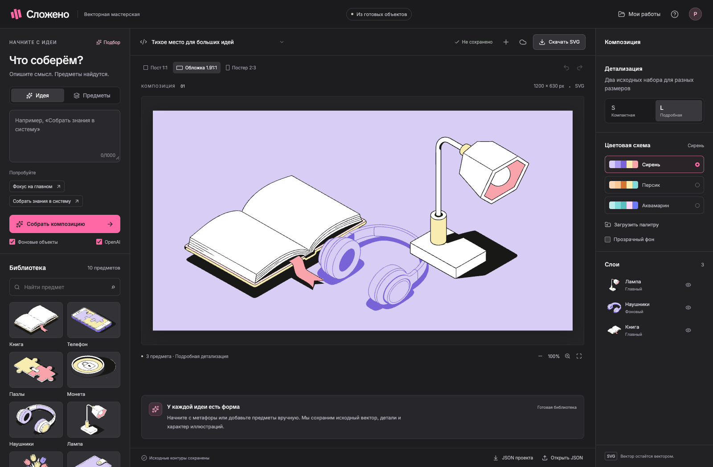

# Сложено · Векторная мастерская

Веб-конструктор иллюстраций по метафоре или названиям предметов. Тестовое задание
для Junior AI Developer в продукт Снэпбилд студии Очень. Это самостоятельная работа
кандидата, не официальный продукт компании.

OpenAI подбирает существующие предметы, алгоритм собирает три композиции,
пользователь редактирует результат и скачивает SVG. Новые контуры не генерируются.



[Короткое демо](docs/evidence/demo.webm) · [Примеры SVG и JSON](examples/compositions/manifest.json)

## Возможности

- Два сценария: метафора/заголовок и точные названия предметов с синонимами.
- 10 семейств, 40 оригинальных вариантов: настоящие S/L × главные/фоновые.
- Три раскладки и три формата: 1000×1000, 1200×630, 800×1200.
- Перемещение мышью/клавиатурой, поворот, дублирование, удаление, слои,
  скрытие, блокировка, undo/redo.
- Три исходные схемы и импорт палитры JSON с автоматической перекраской.
- PostgreSQL, автосохранение, галерея работ сессии, обнаружение конфликта вкладок.
- Самостоятельный редактируемый SVG и переносимый JSON-проект.
- Тёмный интерфейс по мотивам Snapbuild, Inter и TikTok Sans.

## Запуск с Docker

Нужен Docker с Compose. Из корня репозитория:

```bash
cp .env.example .env
# При необходимости заполнить OPENAI_API_KEY и HTTP_PROXY.
docker compose up --build -d
```

Если `.env` уже существует, сохраните его и добавьте недостающие настройки вручную.
Редактор: [127.0.0.1:8017](http://127.0.0.1:8017),
[OpenAPI](http://127.0.0.1:8017/docs). По умолчанию сервис доступен только на localhost.
PostgreSQL сохраняется в отдельном volume `ochen-illustrations_postgres-data`.

```bash
docker compose ps
docker compose logs --tail 50 web
docker compose down
```

`down` сохраняет данные. `down -v` удаляет базу; для обычной остановки этот флаг не нужен.
Другой порт: `OCHEN_APP_PORT=8018 docker compose up --build -d`.
При собственном порте добавьте его origin в `ALLOWED_ORIGINS`.

## Разработка

Нужны Python 3.12+, Node.js 22.12+ и Docker для PostgreSQL:

```bash
make install
make dev
```

Редактор: [127.0.0.1:5178](http://127.0.0.1:5178), API: `127.0.0.1:8017`,
PostgreSQL 17: `127.0.0.1:54329`, база/пользователь `illustrations`.
Пароль разработки задаётся через `POSTGRES_PASSWORD`; его значение должно
совпадать с `DATABASE_URL` в `.env`. Значение по умолчанию предназначено для локального запуска.

Порты выбраны отдельно от других локальных проектов. `make dev` применяет миграции,
запускает оба dev-сервера; Ctrl+C останавливает их. Docker- и native-режимы приложения
занимают один порт 8017, запускайте один из них.

## OpenAI и прокси

```dotenv
OPENAI_API_KEY=
OPENAI_MODEL=gpt-6-luna
HTTP_PROXY=
AI_REQUEST_LIMIT=100
AI_SESSION_LIMIT=20
```

Ключ и прокси находятся только в `.env`, исключённом из Git и Docker build context.
`HTTP_PROXY` явно передаётся HTTPX, включая HTTPS-запросы к OpenAI.
При пустом значении используется прямое соединение.

Модель получает только запрос и небольшой смысловой каталог. Responses API возвращает
строго структурированные ID и объяснение, Pydantic повторно проверяет ответ.
Инструментов рисования, исполнения кода и доступа к SVG у модели нет.
`store=false`, timeout 35 секунд, максимум 700 выходных токенов.
Дневные лимиты по UTC сохраняются в БД, неудачные попытки тоже учитываются.
Небольшой кеш успешных подборов сокращает повторные обращения.
Одновременно выполняются не более двух подборов на процесс и одного на сессию;
повторный запрос отклоняется до списания дневного лимита. V1 запускается одним worker.

Без ключа доступны редактор, подбор названий и явно обозначенный словарный режим.
Словарь ограничен несколькими темами. Сбой OpenAI не заменяет текущую сцену.
Реальное обращение через прокси проверено локально; платные вызовы не входят в CI.
Официальные источники: [модель](https://developers.openai.com/api/docs/models/gpt-6-luna),
[структурированные ответы](https://developers.openai.com/api/docs/guides/structured-outputs).

## Архитектура и SVG

```text
backend/app/          API, схема сцены, подбор, OpenAI, БД, SVG-экспорт
backend/migrations/   Alembic
backend/tests/        модульные и API-регрессии
frontend/src/         React, SVG-холст, история, слои и настройки
frontend/e2e/         Playwright с настоящим API и PostgreSQL
assets/originals/     неизменённые экспорты разделов Figma
assets/library/       извлечённые оригинальные предметы
assets/catalog.json   происхождение, размеры, варианты, хеши и смысловые теги
examples/             демонстрационные композиции и палитра
```

**Хранение:** SVG и каталог версионируются файлами. PostgreSQL хранит Scene JSON,
владельца браузерной сессии, ревизии и лимиты AI. SQLite используется во временных тестах.

**Извлечение:** разделы L/S экспортированы из Figma с ID. Скрипт копирует предметные
группы, добавляет два отдельных контура книги и нормализует начало координат внешним
transform. Path data сохраняется. Воспроизведение без Figma:

```bash
.venv/bin/python scripts/import_catalog.py
```

**Переиспользование:** сцена хранит семейство, детализацию, роль, положение, угол
и порядок экземпляра. Общий масштаб сохраняет относительные размеры исходников.
S/L переключает реальные контуры. Независимое растяжение предметов отключено по ТЗ.

**Цвет:** значения меняются по ролям от неизменённого оригинала. Главные предметы
могут использовать обе группы, фоновые только фоновые слоты. Переключение схем
не накапливает погрешности. Пример импорта: [examples/palette.json](examples/palette.json).

**Экспорт:** отдельные группы, уникальные SVG ID, локальные ссылки и граница холста.
Растр, scripts, XML-сущности, внешние ресурсы и `foreignObject` не используются.

**Сохранение:** HttpOnly-cookie определяет сессию; проекты разных сессий изолированы.
Запись требует CSRF-токен и допустимый origin. Ревизии предотвращают тихую перезапись
другой вкладкой: конфликт позволяет сохранить отдельную копию. Для переноса между
браузерами служит JSON, ссылка с ID без сессии доступа не даёт.

## Проверки

```bash
make check   # tests, Python/frontend lint, format и production build
make e2e     # PostgreSQL, миграции и настоящие браузерные сценарии
```

Локально Playwright использует Google Chrome. Если его нет, выполните
`cd frontend && npx playwright install chromium` и запустите
`CI=true npx playwright test` с остановленными dev-серверами.
GitHub Actions использует отдельный PostgreSQL и Chromium.

Проверяются геометрия, S/L, палитры, ID, безопасный XML, подбор предметов,
ошибки AI, прокси, лимиты, изоляция сессий, ревизии, история, drag, экспорт,
переключение проектов и восстановление. Подменяется только внешний HTTP-транспорт,
реальный код обработки AI проверяется полностью. Результаты: [приёмка](docs/ACCEPTANCE.md).
Локальный итог: 78 Python-тестов, 8 frontend-тестов, 12 сценариев Playwright;
покрытие backend с учётом ветвлений 93%.

Стрелки двигают предмет на 1 px, Shift + стрелки на 10 px. ⌘/Ctrl + Z отменяет,
Shift + ⌘/Ctrl + Z повторяет, ⌘/Ctrl + D дублирует, ⌘/Ctrl + S сохраняет,
Delete удаляет. Поворот доступен в настройках предмета.

## Объём V1

Основной сценарий рассчитан на desktop, на узких экранах панели сворачиваются.
Библиотека подготовлена заранее. Проекты принадлежат текущей сессии браузера.
Логин, совместное редактирование и импорт произвольных SVG не входят в V1.
Код и данные других приватных проектов сюда не переносились.

Дальнейшие улучшения: фиксация предметов при пересборке, адаптация сразу под несколько
форматов, проверка кадрирования главного предмета, оценка подбора на большом наборе метафор.

## Инструменты и источники

- Codex: исследование, архитектура, код, тесты, документация и проверка интерфейса.
- OpenAI GPT-6 Luna: смысловой подбор в работающем приложении.
- Figma MCP и Figma Desktop: чтение ТЗ и получение исходных векторов.
- Playwright: воспроизводимые проверки пользовательских сценариев.

[ТЗ в Figma](https://www.figma.com/design/dnuDZosHkN6ajkhiVfavRw/?node-id=26-11438),
[исследование](docs/RESEARCH.md), [предложение](docs/PROPOSAL.md),
[инструкции агентам](AGENTS.md), [права на исходные иллюстрации](assets/NOTICE.md).
