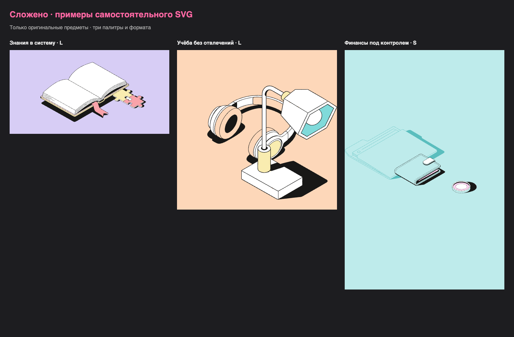

# Локальная проверка V1 · 10 ноября 2026

Кандидат реализован и проверен локально. Ручная приёмка пользователем и серверный
деплой остаются следующими этапами. Этот отчёт не означает, что оценено качество
подбора на произвольном наборе метафор или проведён аудит production-инфраструктуры.

## Автоматические проверки

| Проверка | Наблюдавшийся результат |
|---|---|
| `make check` | Успешно: pytest, Vitest, Ruff/lint/format, ESLint, TypeScript и production build |
| Python | 78 тестов; общее покрытие строк и ветвлений 93% |
| Frontend | 8 тестов состояния редактора и преобразования SVG |
| Playwright | 12 сценариев в Chrome, настоящий FastAPI и PostgreSQL 17 |
| Docker | Образ собран, web и db healthy; браузером проверены подбор, сохранение и reload |
| Публичные файлы | `.env` исключён; проверка шаблонов ключей и HTTP-прокси с авторизацией ничего не нашла |

Внешний HTTP-транспорт OpenAI подменяется в автоматических проверках.
Это позволяет воспроизводить таймауты, отказ, неверные ID, повреждённую структуру
ответа и параллельные запросы без оплаты. Ошибки проверяются через настоящий
код адаптера. Быстрые API-тесты используют временную SQLite; сквозные проверки
сохранения и конфликтов используют PostgreSQL.

Проверки охватывают неизменность path data, весь каталог S/L и цветовые роли,
уникальные ID экземпляров, локальные ссылки градиентов/масок/clipPath/use,
нейтральные цвета масок, безопасный XML и самостоятельность экспорта.
Синтетический SVG с локальными ссылками тестирует случаи, которых нет в текущих
оригинальных предметах.

## Проверка требований

| Требования | Реализация и доказательство |
|---|---|
| R01–R02 | Метафора с OpenAI/явным словарным режимом и точные названия предметов; API и браузерные сценарии |
| R03–R04 | 40 вариантов из оригинальных экспортов; каталог происхождения/хешей, тесты геометрии |
| R05–R06 | Перемещение/поворот/дубликаты/удаление/слои, история; state и Playwright |
| R07–R11 | Настоящие S/L, три схемы и JSON-палитра, роли предметов и общий масштаб; матричные регрессии |
| R12 | Самостоятельный SVG; XML-проверки и повторный импорт одного примера в Figma |
| R13 | Docker и dev-запуск; [короткое демо](evidence/demo.webm), репозиторий |
| R14 | [Архитектура хранения, извлечения и переиспользования](../README.md#архитектура-и-svg) |
| R15 | Список AI-инструментов в README, три [SVG/JSON-примера](../examples/compositions/manifest.json) |

## Реальный OpenAI через прокси

Локальный ключ использован только на backend. Проверены HTTPS-запросы Responses API
через явно переданный HTTPX-прокси из `HTTP_PROXY`, модель `gpt-6-luna`.
Результаты двух реальных запросов сохранены как примеры:

- «Собрать знания в систему»: книга и пазлы.
- «Фокус на главном»: наушники и лампа.
- Третий пример «кошелёк, монета, папка» проверяет точный режим без LLM.

Модель возвращает ID и объяснение. Контуры не передаются для генерации.
Ключ/адрес прокси и платные запросы отсутствуют в тестах CI.
Эти примеры подтверждают интеграцию, но не заменяют оценку большого набора запросов.

## Ручная и браузерная проверка

[Интерфейс](evidence/editor.png) осмотрен в desktop-размере; узкий экран 390×844
проверен в Playwright на доступность холста и отсутствие горизонтального переполнения.
Сравнены три экспортированные композиции: три формата/схемы, обе детализации.

`knowledge.svg` импортирован в отдельный [черновик Figma](https://www.figma.com/design/ydGolr6zVTnk6jW7NKGai0/Untitled).
На холсте видны книга и пазлы, в слоях сохранены вложенные группы и SVG-маска
границы холста. Вложенные группы доступны для выделения, это не растровая картинка.
Исходный файл задания не изменялся. Импорт всех 40 вариантов отдельно в Figma
не проводился; их геометрия и варианты проверены автоматическими тестами.

Docker запущен на `127.0.0.1:8018`, dev-интерфейс на `127.0.0.1:5178`.
Порты других проектов не использовались. На Docker-версии браузером выполнены
режим предметов → сохранение в PostgreSQL → reload → восстановление названия.
Состояние контейнеров healthy проверялось отдельно от этого пользовательского пути.

## Найденные ошибки и регрессии

Независимое ревью проводилось до финального исправления. Найденные важные проблемы
исправлены в `8e41324`; исходный вердикт ревью требовал изменений.

- Запоздавшие генерация/загрузка/проверка палитры могли заменить свежие правки.
  Добавлены проверки актуальности документа и независимое применение палитры.
- Открытие другого проекта могло потерять несохранённую сцену. Переход блокируется
  до сохранения; конфликт позволяет сохранить копию.
- JSON-импорт ошибочно считался чистым документом и сохранял старую ссылку.
  Теперь создаёт новый изменённый документ, получает собственный ID при автосохранении.
- Запись могла вернуть ревизию следующей транзакции. Ответ формируется из
  `UPDATE … RETURNING` до commit; тест воспроизводит дополнительную запись после commit.
- Ctrl+Enter повторно запускал AI, повреждённые структуры ответа могли дать 500.
  Добавлены блокировка повторной отправки, серверный предел параллельности и валидация.
- Импорт с ID встроенной схемы скрывал оригинал. Пользовательские схемы получают
  стабильный ID по цветам, три исходные схемы остаются доступными.
- Дополнительный SVG-fixture выявил перекраску белой маски и необработанные ссылки
  в кавычках. Исправлено в preview и экспорте, добавлены регрессии.

До исправлений были красные проверки для ревизии API, структур ответа, dirty-импорта,
масок/ссылок и браузерных гонок. После исправлений полный набор прошёл.
В ранних браузерных проверках также были ошибки селекторов/точки захвата предмета;
они исправлены по реальному DOM, а не отключением проверяемого поведения.
Первый Docker smoke слишком рано прочитал поле до завершения восстановления;
повторная проверка ждёт фактического сохранённого значения и проходит.

## Практические границы

V1 рассчитана на один процесс backend и сессии одного браузера. Нет регистрации,
совместного редактирования, импорта произвольных SVG, публичного домена и TLS.
Автокомпоновка ограничена тремя алгоритмическими раскладками и готовой библиотекой.
Смысловой подбор может требовать уточнения или ручной корректировки.
Хранилище и дневной бюджет общие для dev- и Docker-версий на этом компьютере.
Публичный запуск потребует отдельной конфигурации окружения, HTTPS и проверки хоста.

## Дополнение: своя тень и favicon

После первой V1 пользователь одобрил opt-in режим «Своя тень». Исходники и обычный
экспорт всех 40 вариантов сверены с 117601c: байты экспорта совпали, SHA исходников
сохранились. Отдельный режим использует маски и векторную художественную проекцию;
он не моделирует блики и физический свет. Для монеты замыкается производная дуга
боковой стенки. Угол локален относительно предмета; процент длины условный.

Ревью выявило зазор тени ручки из-за опоры в пустом месте, обрыв дуги монеты,
потерю глубины наушников и повторную компиляцию SVG при drag. Исправления проверены
регрессиями, включая RED→GREEN для опоры, контура и мемоизации. Уточнены подписи
непрозрачности/системы координат и исправлен отображаемый clamp числового поля.

Текущий полный результат: 128 Python-тестов, 13 frontend-тестов, 13 сценариев
Playwright; покрытие backend с ветвлениями 94%. Старые результаты выше сохранены
как история первой версии. Проверены все 40 очищенных силуэтов. Браузерный сценарий
включает настройки, undo, сохранение/reload, S/L, SVG и восстановление оригинала.

Favicon использует розовый знак из шапки; файл SVG копируется в production build
и возвращается по HTTP. Скриншот режима: [custom-shadow.png](evidence/custom-shadow.png).

Для финального варианта добавлена постоянная регрессия соответствия preview/export: Python и TypeScript сравниваются по DOM для всех 40 вариантов со второй палитрой и углом 247°. Docker: своя тень сохраняется в PostgreSQL и восстанавливается после reload.

## Доработка редактора и доступа, 10 ноября

Текущая партия: единое окно без скролла страницы, одинаковая типографика/отступы,
девять размеров с центрированием композиции, рабочий fullscreen, центрируемый зум
и прокрутка увеличенного холста по двум осям. Библиотека без поиска; галерея с
превью и тем же логотипом; меню SVG/JSON, интерактивная палитра, однократное
приветствие по cookie. В шапке явная кнопка нового проекта; название доступно
для редактирования с карандашом, текстовым курсором и розовой подсветкой без рамки. Статус сохранения — два состояния и одна
галочка, без лишнего облачка. Справка описывает новые кнопки и жесты.

Рамка предмета поддерживает угловой и независимый боковой ресайз, ручку вращения,
плавающую панель и Ctrl/Cmd C/V. Числовой угол и рамка вращают вокруг центра;
кнопки угла работают при удержании, один жест даёт один undo.

Предыдущая проекция силуэта заменена трансформацией видимого исходного отпечатка
тени. Мелкие чёрные обрывки под наушниками удалены масками во всех четырёх вариантах.
Выделение тени мышью, собственные перенос/ресайз/поворот и три последовательных
undo проверены в браузере. Нулевая трансформация сохраняет оригинальный рисунок.
Скрытая за предметом часть тени не выдумывается; это художественная трансформация,
а не реконструкция света. Хеши 40 исходных вариантов и двух исходных экспортов не менялись.

Парольный доступ проверен для страницы/API/библиотеки/OpenAPI, с подписью сессии,
CSRF, ограничением попыток и fail-closed конфигурацией. Вход после истечения auth
выводит из fullscreen; исчезновение сессии владельца обновляет CSRF и сохраняет
текущую сцену новым проектом, не теряя её и историю отмен. Публичного деплоя пока нет.

Мягкий фильтр блокирует явные посторонние команды, а технические/абстрактные темы,
вопросительные и цитированные заголовки принимает. Реальная интеграция через
настроенный HTTP_PROXY: [8 обычных тем, 8 успешных подборов](evidence/ai-topics.json),
2.29–3.97 секунды на запрос. Это ограниченная выборка, не гарантия внешнего сервиса.
Автоматические тесты не делают платных запросов.

Итог: **414 pytest, 34 Vitest, 23 Playwright**, покрытие backend с ветвлениями **95%**;
Ruff, ESLint, TypeScript и production build прошли. Проведено отдельное ревью;
его воспроизводимые замечания по границам масштаба, центру вращения, сохранению
пропорций, смещённой тени и обновлению сессии исправлены с регрессиями.

Сохранённая история диагностики: в первых браузерных запусках было 3, затем 2
сбоя устаревших локаторов после переноса экспорта/палитры; после новых степперов
и двух статусов были 4 сбоя (неоднозначный aria-локатор угла и проверка подстроки
«Сохранено», совпадавшая с «Не сохранено»). Проверки сделаны точными, не ослаблены.
В первом отдельном прогоне выбора тени один клик выбрал предмет; точная причина
не установлена, каталог API до повторов обновлён. Оба новых сценария затем прошли
три раза подряд, а полный итоговый набор 22/22 прошёл без повторных попыток.

Пересобрана локальная Docker-версия `ochen-illustrations-web-1` на 127.0.0.1:8018,
web и PostgreSQL прошли healthcheck. В изолированном Chrome выполнены сохранение
проекта, включение и выделение тени, повторное сохранение и reload: название и тень
восстановлены, ошибок JavaScript нет. Dev-редактор остаётся на 127.0.0.1:5178.
Финальные снимки: [редактор](evidence/editor-polished.png),
[четыре варианта наушников: оригинал / identity / без тени / поворот](evidence/original-shadow-review.png).

Переключатель OpenAI полностью удалён: при настроенном ключе подбор по идее
использует модель автоматически. У «Фоновых объектов» есть поясняющая подсказка
при наведении. Отдельная браузерная регрессия проверяет use_ai=true без UI-переключателя,
подсказку и передачу backgrounds=false после выключения фона; платных вызовов нет.
