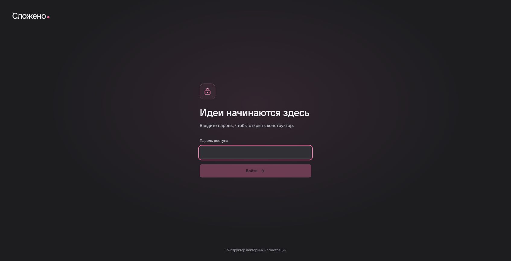

# Журнал выпуска · 11 ноября 2026

**Развёрнуто:** [true-4.ru](https://true-4.ru). Доступ закрыт паролем,
который пользователь задал самостоятельно в Termius. Swagger доступен после входа
на главной странице в том же браузере: [документация API](https://true-4.ru/docs).

## Подтверждённая работающая версия

| Проверка | Наблюдавшийся результат |
|---|---|
| Runtime revision | `245425d5fcab35130f3a9e5db1e2285ae6f3b91b` — OCI label работающего image совпал с выбранным выпуском |
| Runtime image ID | Начинается с `sha256:a8c029e83cf3…`; полный ID сохранён сервером в `release.json` внутри backup |
| Контейнеры | `slozheno-prod-web-1` и `slozheno-prod-db-1` healthy; Alembic `001 (head)` |
| Домен | HTTP 301 → HTTPS; главная 200; `/api/ready` 200 с проверкой PostgreSQL |
| TLS | Сертификат CN `true-4.ru`, действителен до 9 февраля 2027; Chrome открыл страницу без предупреждений |
| Без входа | `/docs`, `/redoc`, `/openapi.json`, `/api/bootstrap` и библиотека — 401 |
| С входом | Настоящий пароль из server env принят; Swagger/ReDoc/schema и 40 исходных вариантов доступны |
| Сессия | Cookie Secure/HttpOnly/SameSite=Lax; после logout docs снова 401; запрос без CSRF — 403 |
| Композиция | Через публичный HTTPS получены три варианта цепочки «лампа на телефоне, ручка на лампе» |
| SVG и палитра | Экспорт всех вариантов, обычный/экспериментальный режимы и кастомная палитра прошли; XML векторный, без raster/script/foreignObject |
| PostgreSQL | Создание, чтение, обновление ревизии и повторное чтение прошли; только созданный QA-проект удалён при очистке |
| OpenAI | Один реальный запрос «Фокус на главном» через настроенный прокси; provider `openai`, `gpt-6-luna`, три варианта |
| Изоляция | У БД нет опубликованных портов, только внутренняя сеть; web опубликован на loopback 18017 |
| Edge | Сеть добавлена декларативно; сравнение структур подтвердило сохранность остальных полей и сервисов; Compose config valid |
| Продление TLS | Существующий Certbot renew-loop подтверждён; наш timer enabled/active, service success/exit 0; повтор без изменения сертификата — no-op |

Это проверки публичного API и страницы входа на production. Полная продуктовая
проверка браузерного редактора относится к зелёному CI ниже и локальной приёмке
пользователем. Повторный импорт production-SVG в Figma в этом выпуске не выполнялся:
редактируемость SVG проверена в принятом продуктовом baseline; код экспортёра не менялся.

Runtime остаётся на `245425d`: последующие commits добавляют эксплуатационные helper/units
и отчёт, а не новый код редактора/API. Установленные helper/units взяты из `3b5923f`;
`bash -n`, `systemd-analyze verify`, контрольный запуск и проверка timer прошли на сервере.

## Backup и откат

Защищённый каталог `/opt/slozheno-backups/activation-20261111T100920Z` содержит
дамп PostgreSQL, env, конфигурацию edge/Compose и `release.json`. Каталог `0700`,
секретные файлы `0600`; дамп непустой, `pg_restore --list` успешно проверен.
Перед добавлением внешней сети отдельно сохранён `edge-compose-before.json`.
Первоначальная конфигурация edge также сохранена в `20261111T093740Z`.
Значения секретов и сами backups в Git не попадают.

При проблеме первого выпуска остановить только наш web и вернуть **только наш
маркированный блок** домена к bootstrap 503. Другие домены, текущую БД и volume
сохранять. Не заменять весь общий edge старой копией: другие задачи могли обновить
его после backup. [Полная инструкция](DEPLOYMENT.md).

## Продуктовая приёмка

Пользователь принял локальную обычную и экспериментальную версии 11 ноября.
Продуктовый baseline: `8bf51d25a791434296004b12099c968d474b269c`.
[CI baseline — success](https://github.com/sayan021dev/ochen_test_work/actions/runs/42920605371):
1857 pytest, 172 Vitest, 58 Playwright. Это наблюдения предыдущего продуктового SHA.

## Production-подготовка

- Авторизован деплой через Termius на T2T Ivan server, домен `true-4.ru`.
- После освобождения Termius другой задачей фактически проверены hostname,
  пользователь, Docker Compose, место/память, listening ports, сети/mounts edge.
- DNS A совпал с IPv4 этого хоста; отдельного checkout проекта ещё не было.
- Подготовлены отдельный production Compose, OCI revision label, ограниченные
  сети/порты, Nginx HTTP/HTTPS, скрытая форма и [runbook](DEPLOYMENT.md).
- Пароль пользователь задаёт сам в Termius. Значения не публикуются.
- Проверки release-кандидата: 1868 pytest (80,73 с), backend coverage с ветвлениями 96%,
  172 Vitest, Ruff/ESLint/TypeScript и production build прошли.
- Реальный изолированный Docker-контейнер подтвердил точную передачу тестовых
  пароля/ключа со спецсимволами. Тест реального FastAPI подтвердил анонимный 401
  Swagger/ReDoc/schema, вход с Secure-cookie, доступ после входа и блокировку после выхода.
- После обновления описания OpenAPI: 43 API/auth-теста прошли; 2/2 Playwright
  сценария входа/продления авторизации прошли за 12,2 с. Полный продуктовый браузерный
  baseline — 58 сценариев в указанном выше CI.
- Release-кандидат `a56e77ded8b86107b4da8edaafef506ce142f53b` опубликован в main;
  [его полный CI](https://github.com/sayan021dev/ochen_test_work/actions/runs/42996368504)
  завершился **success**, включая Python, frontend и полный Playwright.

## История: состояние сервера перед вводом пароля

- `/opt/slozheno` создан отдельно, получен проверенный коммит `a56e77d`.
- Успешно собран image `slozheno-web:a56e77ded8b86107b4da8edaafef506ce142f53b`.
  Это собранный образ; приложение и PostgreSQL ещё не запущены.
- Backup edge проверен побайтово: `/opt/slozheno-backups/20261111T093740Z/edge-before.conf`;
  каталог `0700`, файл `0600`, рядом SHA256 исходной конфигурации.
- Добавлен только маркированный HTTP-блок нашего домена, `nginx -t` прошёл,
  graceful reload выполнен. Контрольный запрос с Host `true-4.ru` вернул 503.
  Первое измерение сразу после reload ещё получило старый 301; повтор подтвердил 503.
- Первый Certbot не выбрал один из двух существующих ACME-аккаунтов. Повторный
  запрос отправлен с уже используемым аккаунтом; наличие/срок нового сертификата
  ещё нужно подтвердить. Успех получения TLS пока не заявляется.
- На этом этапе Termius снова был занят другой задачей. После освобождения требовалось выбрать T2T Ivan,
  проверить hostname, проверить TLS и только затем открыть скрытую форму.
  `.env.production` и пользовательский пароль в этой задаче ещё не создавались.

## Активация

После освобождения Termius пользователь завершил скрытую форму. Проверены права
env `0600`, выполнены build/up/readiness, backup базы и конфигурации, переключение
на HTTPS и проверки из итоговой таблицы. Общий Nginx получил только наш domain-блок
и дополнительную сеть; другие приложения не пересоздавались.
