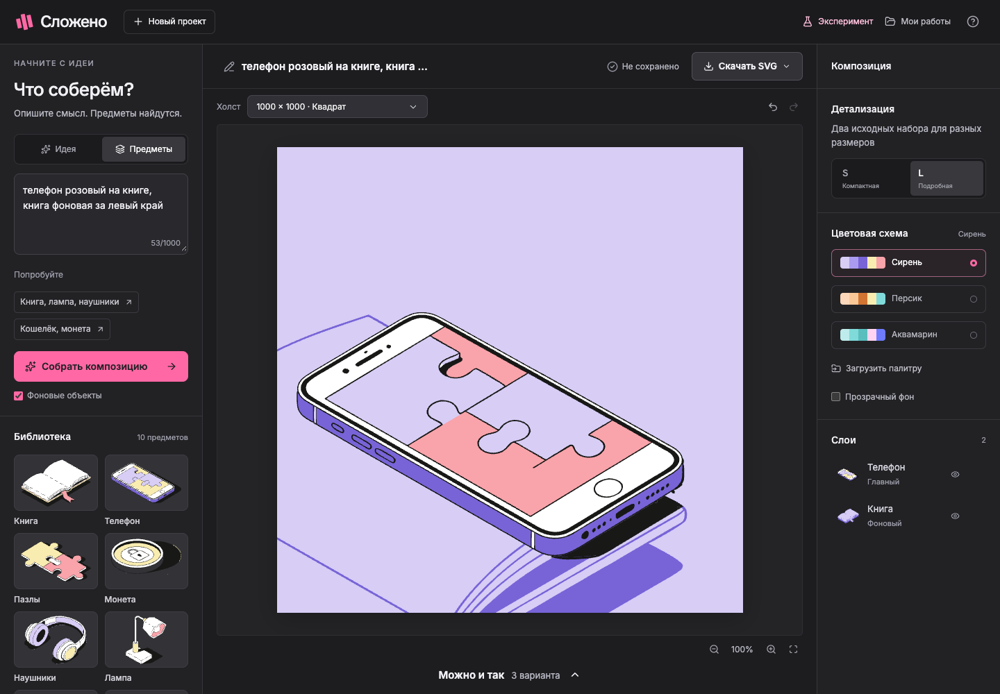
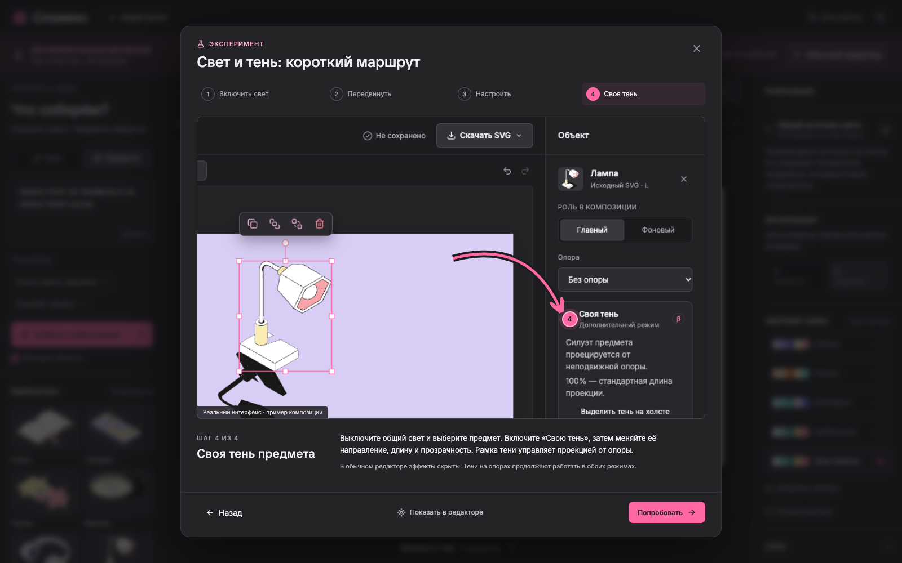
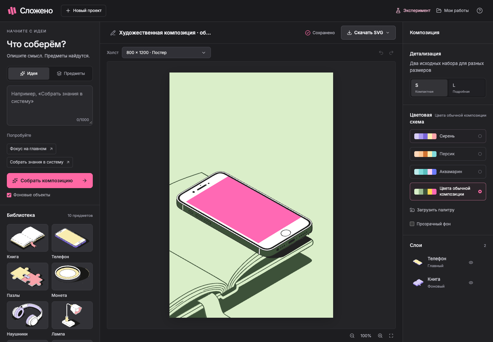

# Принятая V1 · 11 ноября 2026

Пользователь проверил обычный и экспериментальный редакторы и подтвердил,
что текущее поведение его устраивает. Это итог локальной продуктовой приёмки.
Публичное развёртывание проверяется отдельно по [инструкции выпуска](DEPLOYMENT.md).

## Что сдаём

Python/FastAPI + React/TypeScript/Vite, нативный SVG и PostgreSQL 17.
Один сервер приложения, миграции Alembic, один worker; OpenAI работает только
на backend через заданный HTTPS-прокси. Ключи и пароль отсутствуют в репозитории.

Два сценария ввода: идея/метафора и названия предметов. В библиотеке 10 семейств,
40 исходных вариантов S/L и главных/фоновых ролей. Три альтернативы сохраняют
заданные отношения, относительные размеры, цветовые роли и указания кадрирования.
Редактор поддерживает ручную компоновку, рамку, поворот, слои, clipboard, историю,
форматы, палитры, автосохранение, галерею и экспорт SVG/JSON.

## Обычные и экспериментальные тени

При открытии всегда включён обычный режим. Исходные тени попадают на видимые
поверхности ниже по слоям; явные опоры ограничивают приёмники и убирают тень в воздухе.
Маски и контуры остаются векторными, файлы оригинальных предметов не переписываются.

В экспериментальную мастерскую пользователь входит отдельно. Там доступны общий
источник света, его положение/высота/плотность, индивидуальная проекция силуэта,
её направление и длина. Пошаговая инструкция содержит скриншоты, стрелки и переход
к соответствующим элементам редактора. Выход сохраняет настройки, но выключает
эксперимент в обычном preview/экспорте. Галерея показывает обычные превью.

Это 2D-имитация, а не физический 3D-рендер: исходные блики не перестраиваются.
`CUSTOM_SHADOWS_ENABLED=false` скрывает эксперимент целиком, сохраняя обычные тени
и данные проекта. Для экспериментального SVG нужен `experimental=true`.

## Пользовательская палитра

Кнопка «Загрузить палитру» открывает окно создания/импорта. Можно выбрать цвета
интерактивно или открыть [JSON-пример](../examples/palette.json). В каждой группе
`background` и `object` — четыре HEX-цвета. Фоновые предметы используют только
фоновые слоты; перекраска не затрагивает геометрию. Палитра переносится с JSON-проектом.

## Доказательства и пределы проверки

Финальный продуктовый коммит `8bf51d2` прошёл [GitHub Actions](https://github.com/sayan021dev/ochen_test_work/actions/runs/42920605371):
1857 pytest, 172 Vitest, 58 Playwright. Локальное покрытие backend с ветвлениями — 95%.
Результаты этой версии не называются новой проверкой последующих deployment-изменений.

Отдельно: 324/324 проверки художественного аудита, визуальная сверка всех строк,
S/L, трёх альтернатив, палитр, контактов и дробных масштабов. Финальные SVG
повторно импортированы в Figma с доступными векторными контурами; реальные обращения
OpenAI через прокси проверены отдельно от бесплатных регрессий.

- [Подробная финальная проверка](ART_DIRECTION_ACCEPTANCE.md).
- [Сравнение с Figma и новые запросы](../examples/art-direction/index.html).
- [История приёмки](ACCEPTANCE.md), включая прежние ошибки и исправления.
- [Исходное исследование требований](RESEARCH.md), [одобренное предложение](PROPOSAL.md).

Алгоритм обобщает композиционные приёмы, не подставляет готовые координаты Figma.
Пиксельное повторение дизайнерских примеров, декоративные подложки, произвольный
импорт SVG, аккаунты и совместное редактирование не входят в V1. Проекты принадлежат
сессии браузера; для переноса используется JSON. Общий пароль ограничивает доступ
проверяющих, но не заменяет индивидуальные аккаунты. Внешний AI может быть недоступен;
ошибка сохраняет текущую композицию и отображается пользователю.
